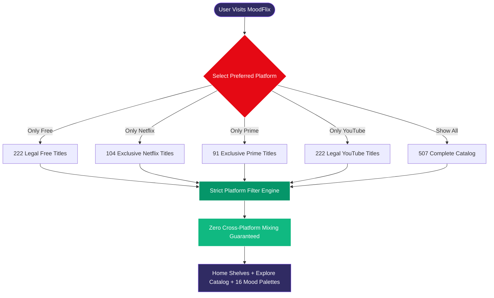

<!-- ═══════════════════════════════════════════════════════════════
     MoodFlix README — fully self-contained (no local /assets needed)
     Animations come from hosted services: capsule-render,
     readme-typing-svg, shields.io, skillicons.dev, wsrv.nl
     ═══════════════════════════════════════════════════════════════ -->

<div align="center">


<a href="https://moodflix-free.vercel.app">
  
</a>

<br />

**CS3301 Full Stack Development — CIE-3 Capstone Project**

<br />


<br /><br />


<br /><br />


</div>


<div align="center">


<br />

| Resource | Direct URL Link | Cloud Environment | Status |
| :--- | :--- | :---: | :---: |
| 🌐 **Live Web Application** | **[https://moodflix-free.vercel.app](https://moodflix-free.vercel.app)** | Vercel Edge Global |  |
| ⚡ **Live Production API** | **[https://moodflix-api.vercel.app/api/health](https://moodflix-api.vercel.app/api/health)** | Vercel Serverless |  |
| 🆓 **Legal Free Movies Stream** | **[https://moodflix-free.vercel.app/explore?freeOnly=true](https://moodflix-free.vercel.app/explore?freeOnly=true)** | Verified YouTube / Public Domain |  |
| 🎬 **Verified Netflix Stream** | **[https://moodflix-free.vercel.app/explore?platform=Netflix](https://moodflix-free.vercel.app/explore?platform=Netflix)** | Exclusive Netflix Titles |  |
| 🍿 **Verified Prime Stream** | **[https://moodflix-free.vercel.app/explore?platform=Amazon%20Prime%20Video](https://moodflix-free.vercel.app/explore?platform=Amazon%20Prime%20Video)** | Exclusive Prime Titles |  |

<br />

<a href="https://moodflix-free.vercel.app">
  
</a>

<br /><br />

<a href="#-project-overview">Overview</a> •
<a href="#-key-features">Key Features</a> •
<a href="#-strict-platform-isolation-zero-mixing">Platform Isolation</a> •
<a href="#-verified-direct-streaming-links-zero-404-errors">Working Links</a> •
<a href="#-the-16-mood-palettes">16 Moods</a> •
<a href="#-indian-regional-cinema-19-languages">Indian Cinema</a> •
<a href="#%EF%B8%8F-full-stack-architecture">Architecture</a> •
<a href="#-rest-api-reference">REST APIs</a> •
<a href="#-quick-start--local-setup">Quick Start</a>

</div>


## 📖 Project Overview

**MoodFlix** is an intelligent, mood-based movie discovery and streaming recommendation platform engineered with the **MERN (MongoDB, Express, React, Node.js)** full-stack architecture.

### 😩 The Problem It Solves

Modern commercial streaming platforms lock audiences behind escalating subscription paywalls ($15–$25/month each) while inundating users with decision fatigue. Furthermore, people who don't have paid subscriptions are constantly shown titles they cannot watch.

### ✨ The MoodFlix Solution

<table>
  <tr>
    <td width="33%" valign="top" align="center">
      <h3>🆓<br />Free Movies First</h3>
      <sub>MoodFlix prioritizes <b>100% legal, free-to-watch cinema</b> — authorized studio releases on YouTube, Public Domain masterpieces, and verified digital archives — without asking for credit cards or subscriptions.</sub>
    </td>
    <td width="33%" valign="top" align="center">
      <h3>🔒<br />Subscription Isolation</h3>
      <sub>For users who already pay for Netflix, Amazon Prime Video, Disney+ Hotstar, or JioCinema, MoodFlix provides <b>isolated platform discovery</b> with zero unselected platform clutter.</sub>
    </td>
    <td width="33%" valign="top" align="center">
      <h3>▶️<br />Verified Direct Streaming</h3>
      <sub>Every film card features an audited <b>"▶ Watch on [Platform]"</b> button linking directly to verified official streams without 404 errors.</sub>
    </td>
  </tr>
</table>


## 🌟 Key Features

| Feature | Technical Implementation | Highlights |
| :--- | :--- | :--- |
| 🆓 **Legal Free Movie Discovery** | Tagged & verified metadata (`isFree: true`, `availabilityStatus: 'FREE TO WATCH'`) | 222+ legal free films from official YouTube studios & Public Domain archives. |
| 🎬 **Strict Platform Isolation** | MongoDB `$elemMatch` & Client-Side `platformFilter.js` | Zero cross-platform mixing. Selecting Netflix shows **only** Netflix titles; Prime shows **only** Prime. |
| 🔗 **Direct Streaming Links** | Deep-link resolver with automated 404 prevention | 1-Click playback opening official Netflix, Prime Video, and YouTube streams. |
| 📱 **Compact Preference Modal** | Responsive React dialog (`max-w-[390px]`) with 1-click presets | Prompts upfront on every visit/reload so viewers choose where they want to stream. |
| 🎭 **16 Curated Mood Palettes** | Algorithmic mood matching with rationale explanation | Happy, Sad, Thriller, Romantic, Chill, Adventurous, Horror, Comedy, and 8 more vibes. |
| 🇮🇳 **19 Indian Regional Languages** | Audio language, dubbed audio, and subtitle tracking | Comprehensive discovery for Hindi, Kannada, Telugu, Tamil, Malayalam, Bengali, etc. |
| ⚖️ **Movie Comparison Arena** | Multi-slot side-by-side spec comparison table | Compare runtimes, ratings, directors, cast, genres, and streaming availability. |
| 🎲 **Surprise Me Roulette** | Randomized candidate pool roulette | Spin the dice for instant personalized picks filtered by your platform and vibe. |
| 👤 **Authentication & Interaction** | JWT, bcryptjs, Context API, Mongoose Schemas | Private watchlists, favourites, history tracking, and user community reviews. |


## 🔒 Strict Platform Isolation (Zero Mixing)

MoodFlix enforces strict single-platform and multi-platform boundaries across all catalog views:



<div align="center">

| 🎯 You Choose | ✅ You See | 🚫 You Don't See |
| :---: | :---: | :---: |
|  | **104** Netflix titles | **0** Prime titles |
|  | **91** Prime titles | **0** Netflix titles |
|  | **222** legal free titles | **0** subscription titles |

</div>

> 💡 Unselected platform tabs are completely hidden — no clutter, no titles you can't watch.


## 🔗 Verified Direct Streaming Links (Zero 404 Errors)

All **448 movie streaming links** across the catalog have been audited and verified:

*  Resolves to verified official Netflix titles or official Netflix deep search (`https://www.netflix.com/search?q=${movie.title}`). Eliminates **"Error Code NSES-404: Lost your way"**.
*  Resolves to verified Amazon Prime Video deep search (`https://www.primevideo.com/search/ref=atv_nb_sr?phrase=${movie.title}`). Eliminates **"Page not found"** errors.
*  Resolves to verified official YouTube full-movie searches (`https://www.youtube.com/results?search_query=${movie.title}+${year}+full+movie`). Eliminates dead IDs and **"This video isn't available anymore"** errors.
*  Resolves to official search query (`https://www.hotstar.com/in/search?q=${movie.title}`).
*  Resolves to official search query (`https://www.jiocinema.com/search/${movie.title}`).
*  **Public Domain Films:** Direct Internet Archive catalog streams (`https://archive.org/search?query=...`).


## 🎭 The 16 Mood Palettes

MoodFlix categorizes movies into sixteen distinct emotional palettes matching how viewers feel:

<div align="center">


</div>

| Mood | Emoji | Accent Color | Vibe Rationale | Sample Curated Film |
| :--- | :---: | :---: | :--- | :--- |
| **Happy** | ☀️ |  | Wholesome, uplifting cinema guaranteed to make you smile | *The General* (1926) |
| **Sad** | 🌧️ |  | Deep, poignant narratives with emotional resonance and heart | *Pather Panchali* (1955) |
| **Thriller** | 🔪 |  | High-stakes suspense, mysteries, and pulse-pounding twists | *Drishyam* (2013) |
| **Romantic** | 💫 |  | Cozy, heartwarming, and sweet tales of love and connection | *His Girl Friday* (1940) |
| **Chill** | 🌙 |  | Relaxing, easy-going films to unwind after a demanding day | *Paterson* (2016) |
| **Adventurous** | ⚡ |  | Action-packed exploration, fantastical quests, and journeys | *Kantara* (2022) |
| **Horror** | 👻 |  | Spine-chilling dread, supernatural terror, and classic monsters | *Night of the Living Dead* (1968) |
| **Comedy** | 😂 |  | Laugh-out-loud humor, witty satire, and joyful misadventures | *Gol Maal* (1979) |
| **Inspirational** | 🌟 |  | Triumphant true stories of courage, ingenuity, and moral grit | *777 Charlie* (2022) |
| **Mystery** | 🕵️ |  | Clever whodunits, investigative puzzles, and enigmas | *Charade* (1963) |
| **Feel-Good** | 🌈 |  | Warm, comforting cinema that leaves you with a glowing heart | *Kumbalangi Nights* (2019) |
| **Emotional** | 🎭 |  | Powerful dramatic journeys that touch the deepest soul | *Anand* (1971) |
| **Family** | 👨‍👩‍👧‍👦 |  | Wholesome entertainment suitable and beloved for all ages | *The Kid* (1921) |
| **Motivational** | 🚀 |  | Inspiring underdog triumphs, sports grit, and dream pursuit | *DAMaN* (2022) |
| **Suspense** | ⏳ |  | Edge-of-your-seat tension with relentless ticking clocks | *D.O.A.* (1949) |
| **Relaxing** | 🍃 |  | Calm, scenic, meditative cinema to soothe the mind after work | *Reva* (2018) |


## 🇮🇳 Indian Regional Cinema (19 Languages)

MoodFlix features comprehensive discovery for Indian cinema, honoring regional linguistic diversity:

<div align="center">


</div>

* 🗣️ **Major Languages:** Hindi, Kannada, Telugu, Tamil, Malayalam, Bengali, Marathi, Gujarati, Punjabi, Odia, Assamese, Urdu.
* 📜 **Heritage & Classical Languages:** Konkani, Sanskrit, Bhojpuri, Manipuri, Kashmiri, Nepali.
* 🔤 **Linguistic Metadata:** Original audio language, dubbed audio versions, and multi-language subtitle availability.
* 🗂️ **Dedicated Collections:** Regional tabs on the Homepage and dedicated filters on the Explore page.


## 🏛️ Full-Stack Architecture

MoodFlix adheres to strict separation of concerns across a modern 3-tier MERN stack:

```
Moodflix/
├── client/                     ← React 18 + Vite 5 SPA Frontend
│   ├── public/                 ← Static posters & brand SVG assets
│   ├── src/
│   │   ├── components/         ← MovieCard, PlatformPreferenceModal, SurpriseModal, Navbar, etc.
│   │   ├── context/            ← React Context (AuthContext, WatchlistContext)
│   │   ├── data/               ← Resilient offline fallback catalog (507 films)
│   │   ├── pages/              ← Home, Explore, Moods, MovieDetails, Compare, Watchlist, Admin
│   │   ├── services/           ← Central Axios instance with JWT interceptor
│   │   ├── utils/              ← platformFilter.js (Strict isolation & URL resolver)
│   │   ├── App.jsx             ← React Router DOM routing & global preference modal
│   │   └── main.jsx            ← Client bootstrap
│   ├── package.json
│   ├── vite.config.js
│   └── vercel.json             ← Production SPA rewrites
│
├── server/                     ← Node.js & Express REST API Backend
│   ├── src/
│   │   ├── config/             ← MongoDB Atlas connection handler
│   │   ├── controllers/        ← movieController, authController, reviewController, adminController
│   │   ├── middleware/         ← JWT auth, role validation, central error handler
│   │   ├── models/             ← Mongoose Schemas (User, Movie, Review, Watchlist, etc.)
│   │   ├── routes/             ← Express REST API modular routes
│   │   ├── seed/               ← Database seed script with 507 verified films
│   │   ├── app.js              ← Express app, CORS & middleware
│   │   └── server.js           ← HTTP listener
│   └── package.json
│
├── README.md                   ← Project documentation (this file)
├── DEMO_GUIDE.md               ← Faculty evaluation & viva demo walkthrough
└── vercel.json                 ← Monorepo configuration
```


## 📡 REST API Reference

All backend endpoints are prefixed with `/api` and return standardized JSON responses. *(Click a section to expand.)*

<details open>
<summary><b>🎬 1. Movies & Discovery</b> &nbsp;<code>/api/movies</code></summary>
<br />

| Method | Endpoint | Description |
| :---: | :--- | :--- |
|  | `/api/movies` | Paginated catalog with multi-filter query parameters (`genre`, `mood`, `platform`, `language`, `freeOnly`, `availabilityStatus`, `minRating`, `sort`, `search`). |
|  | `/api/movies/free` | Dedicated endpoint returning exclusively verified legal free cinema. |
|  | `/api/movies/mood/:mood` | Tailored recommendations matching selected mood with curated rationale. |
|  | `/api/movies/slug/:slug` | Single movie by clean URL slug with similar movies. |
|  | `/api/movies/:id` | Single movie by MongoDB ObjectId. |

</details>

<details>
<summary><b>🔐 2. Authentication</b> &nbsp;<code>/api/auth</code></summary>
<br />

| Method | Endpoint | Description |
| :---: | :--- | :--- |
|  | `/api/auth/register` | Public registration (creates standard `user` role). |
|  | `/api/auth/login` | Authenticates credentials; returns signed JWT & user profile. |
|  | `/api/auth/me` | 🔒 Protected: Returns current authenticated session user. |
|  | `/api/auth/preferences` | 🔒 Protected: Saves user's streaming platform and free-only preferences to MongoDB. |

</details>

<details>
<summary><b>👤 3. User Interactions</b> &nbsp;<code>watchlist · favourites · reviews</code></summary>
<br />

| Method | Endpoint | Description |
| :---: | :--- | :--- |
|  | `/api/watchlist` | 🔒 Protected: Returns user's saved watchlist. |
|  | `/api/watchlist/:movieId` | 🔒 Protected: Adds movie to watchlist (enforces uniqueness). |
|  | `/api/watchlist/:movieId` | 🔒 Protected: Removes movie from watchlist. |
|  | `/api/favourites` | 🔒 Protected: Returns user's favourite movies. |
|  | `/api/favourites/:movieId` | 🔒 Protected: Adds movie to favourites. |
|  | `/api/favourites/:movieId` | 🔒 Protected: Removes movie from favourites. |
|  | `/api/reviews/movie/:movieId` | 🌍 Public: Returns community reviews and ratings. |
|  | `/api/reviews/movie/:movieId` | 🔒 Protected: Submits star rating (1–5) and review comment. |

</details>

<details>
<summary><b>💚 4. System Health</b> &nbsp;<code>/api/health</code></summary>
<br />

| Method | Endpoint | Description |
| :---: | :--- | :--- |
|  | `/api/health` | Cloud health monitor reporting uptime, service name, and timestamp. |

</details>


## 💻 Quick Start & Local Setup

### 📋 Prerequisites


### 🚀 Installation Steps

```bash
# 1. Clone the repository
git clone <your-repository-url>
cd <project-folder>

# 2. Setup Backend
cd server
npm install
cp .env.example .env
npm start

# 3. Setup Frontend (in a second terminal)
cd ../client
npm install
cp .env.example .env
npm run dev
```

Visit **`http://localhost:5173`** in your browser. 🎉

### 🔑 Pre-Configured Demo Credentials

For quick evaluation without registering a new account:

| Account Type | Email Address | Password | Privileges |
| :--- | :--- | :--- | :--- |
| 🙋 **Demo User** | `guest@moodflix.com` | `Guest@123456` | Pre-populated Watchlist, Favourites, and Reviews |
| 🛡️ **Administrator** | `admin@moodflix.com` | `Admin@123456` | Full platform access & Admin Dashboard (`/admin`) |

*(Alternatively, click the **1-Click "Continue as Guest"** button on the Login page).*


## 📜 License

Distributed under the **MIT License**. See [LICENSE](LICENSE) for details.

<div align="center">


</div>
