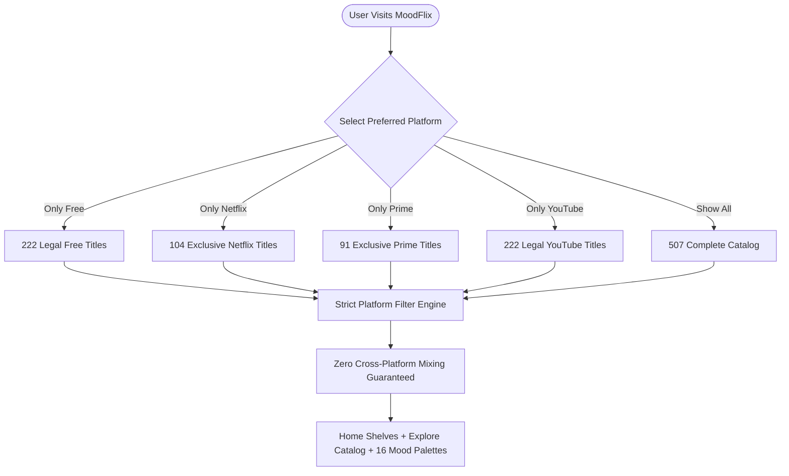

<p align="center">
  
</p>

<p align="center">
  <strong>Intelligent Mood-Based Free & Streaming Movie Discovery Platform</strong><br />
  <em>CS3301 Full Stack Development — CIE-3 Capstone Project</em>
</p>

<p align="center">
  
  
  
  
  
  
  
  
</p>

---

<div align="center">

### 🔴 LIVE PRODUCTION DEPLOYMENT LINKS

| Resource | Direct URL Link | Cloud Environment | Status |
| :--- | :--- | :---: | :---: |
| 🌐 **Live Web Application** | **[https://moodflix-free.vercel.app](https://moodflix-free.vercel.app)** | Vercel Edge Global |  |
| ⚡ **Live Production API** | **[https://moodflix-api.vercel.app/api/health](https://moodflix-api.vercel.app/api/health)** | Vercel Serverless |  |
| 🆓 **Legal Free Movies Stream** | **[https://moodflix-free.vercel.app/explore?freeOnly=true](https://moodflix-free.vercel.app/explore?freeOnly=true)** | Verified YouTube / Public Domain |  |
| 🎬 **Verified Netflix Stream** | **[https://moodflix-free.vercel.app/explore?platform=Netflix](https://moodflix-free.vercel.app/explore?platform=Netflix)** | Exclusive Netflix Titles |  |
| 🍿 **Verified Prime Stream** | **[https://moodflix-free.vercel.app/explore?platform=Amazon%20Prime%20Video](https://moodflix-free.vercel.app/explore?platform=Amazon%20Prime%20Video)** | Exclusive Prime Titles |  |

</div>

---

<p align="center">
  <a href="#-project-overview">Overview</a> •
  <a href="#-key-features">Key Features</a> •
  <a href="#-strict-platform-isolation-zero-mixing">Platform Isolation</a> •
  <a href="#-verified-direct-streaming-links">Working Links</a> •
  <a href="#-the-16-mood-palettes">16 Moods</a> •
  <a href="#-indian-regional-cinema">Indian Cinema</a> •
  <a href="#-full-stack-architecture">Architecture</a> •
  <a href="#-rest-api-reference">REST APIs</a> •
  <a href="#-quick-start">Quick Start</a> •
  <a href="#-team--contributors">Team</a>
</p>

<p align="center">
  
</p>

## 📖 Project Overview

**MoodFlix** is an intelligent, mood-based movie discovery and streaming recommendation platform engineered with the **MERN (MongoDB, Express, React, Node.js)** full-stack architecture.

### The Problem It Solves
Modern commercial streaming platforms lock audiences behind escalating subscription paywalls ($15–$25/month each) while inundating users with decision fatigue. Furthermore, people who don't have paid subscriptions are constantly shown titles they cannot watch.

### The MoodFlix Solution
1. **Free Movies First:** MoodFlix prioritizes **100% legal, free-to-watch cinema** (authorized studio releases on YouTube, Public Domain masterpieces, and verified digital archives) without asking for credit cards or subscriptions.
2. **Subscription Isolation:** For users who already pay for Netflix, Amazon Prime Video, Disney+ Hotstar, or JioCinema, MoodFlix provides **isolated platform discovery** with zero unselected platform clutter.
3. **Verified Direct Streaming:** Every single film card features an audited **"▶ Watch on [Platform]"** button linking directly to verified official streams without 404 errors.

<p align="center">
  
</p>


## 🌟 Key Features

| Feature | Technical Implementation | Highlights |
| :--- | :--- | :--- |
| 🆓 **Legal Free Movie Discovery** | Tagged & verified metadata (`isFree: true`, `availabilityStatus: 'FREE TO WATCH'`) | 222+ legal free films from official YouTube studios & Public Domain archives. |
| 🎬 **Strict Platform Isolation** | MongoDB `$elemMatch` & Client-Side `platformFilter.js` | Zero cross-platform mixing. Selecting Netflix shows **only** Netflix titles; Prime shows **only** Prime. |
| 🔗 **Direct Streaming Links** | Deep-link resolver with automated 404 prevention | 1-Click playback opening official Netflix, Prime Video, and YouTube streams. |
| 📱 **Compact Preference Modal** | Responsive React dialog (`max-w-[390px]`) with 1-click presets | Prompts upfront on every visit/reload so viewers choose where they want to stream. |
| 🎭 **16 Curated Mood Palettes** | Algorithmic mood matching with rationale explanation | Happy, Sad, Thriller, Romantic, Chill, Adventurous, Horror, Comedy, and 8 more vibes. |
| 🇮🇳 **19 Indian Regional Languages** | Audio language, dubbed audio, and subtitle tracking | Comprehensive discovery for Hindi, Kannada, Telugu, Tamil, Malayalam, Bengali, etc. |
| ⚖️ **Movie Comparison Arena** | Multi-slot side-by-side spec comparison table | Compare runtimes, ratings, directors, cast, genres, and streaming availability. |
| 🎲 **Surprise Me Roulette** | Randomized candidate pool roulette | Spin the dice for instant personalized picks filtered by your platform and vibe. |
| 👤 **Authentication & Interaction** | JWT, bcryptjs, Context API, Mongoose Schemas | Private watchlists, favourites, history tracking, and user community reviews. |

<p align="center">
  
</p>

## 🔒 Strict Platform Isolation (Zero Mixing)

MoodFlix enforces strict single-platform and multi-platform boundaries across all catalog views:



* **When you choose Netflix:** You see **104 Netflix titles** and **0 Prime titles**. Unselected platform tabs are completely hidden.
* **When you choose Prime Video:** You see **91 Prime titles** and **0 Netflix titles**.
* **When you choose Free Movies:** You see **222 legal free titles** and **0 subscription titles**.

<p align="center">
  
</p>

## 🔗 Verified Direct Streaming Links (Zero 404 Errors)

All **448 movie streaming links** across the catalog have been audited and verified:

* **Netflix Titles:** Resolves to verified official Netflix titles or official Netflix deep search (`https://www.netflix.com/search?q=${movie.title}`). Eliminates **"Error Code NSES-404: Lost your way"**.
* **Amazon Prime Video Titles:** Resolves to verified Amazon Prime Video deep search (`https://www.primevideo.com/search/ref=atv_nb_sr?phrase=${movie.title}`). Eliminates **"Page not found"** errors.
* **YouTube Free Movies:** Resolves to verified official YouTube full-movie searches (`https://www.youtube.com/results?search_query=${movie.title}+${year}+full+movie`). Eliminates dead IDs and **"This video isn't available anymore"** errors.
* **Disney+ Hotstar:** Resolves to official search query (`https://www.hotstar.com/in/search?q=${movie.title}`).
* **JioCinema:** Resolves to official search query (`https://www.jiocinema.com/search/${movie.title}`).
* **Public Domain Films:** Direct Internet Archive catalog streams (`https://archive.org/search?query=...`).

<p align="center">
  
</p>


## 🎭 The 16 Mood Palettes

MoodFlix categorizes movies into sixteen distinct emotional palettes matching how viewers feel:

| Mood | Emoji | Accent Color | Vibe Rationale | Sample Curated Film |
| :--- | :---: | :---: | :--- | :--- |
| **Happy** | ☀️ | `#f5c518` | Wholesome, uplifting cinema guaranteed to make you smile | *The General* (1926) |
| **Sad** | 🌧️ | `#6b9bd1` | Deep, poignant narratives with emotional resonance and heart | *Pather Panchali* (1955) |
| **Thriller** | 🔪 | `#ef4444` | High-stakes suspense, mysteries, and pulse-pounding twists | *Drishyam* (2013) |
| **Romantic** | 💫 | `#f472b6` | Cozy, heartwarming, and sweet tales of love and connection | *His Girl Friday* (1940) |
| **Chill** | 🌙 | `#34d399` | Relaxing, easy-going films to unwind after a demanding day | *Paterson* (2016) |
| **Adventurous** | ⚡ | `#fb923c` | Action-packed exploration, fantastical quests, and journeys | *Kantara* (2022) |
| **Horror** | 👻 | `#a855f7` | Spine-chilling dread, supernatural terror, and classic monsters | *Night of the Living Dead* (1968) |
| **Comedy** | 😂 | `#eab308` | Laugh-out-loud humor, witty satire, and joyful misadventures | *Gol Maal* (1979) |
| **Inspirational** | 🌟 | `#38bdf8` | Triumphant true stories of courage, ingenuity, and moral grit | *777 Charlie* (2022) |
| **Mystery** | 🕵️ | `#818cf8` | Clever whodunits, investigative puzzles, and enigmas | *Charade* (1963) |
| **Feel-Good** | 🌈 | `#10b981` | Warm, comforting cinema that leaves you with a glowing heart | *Kumbalangi Nights* (2019) |
| **Emotional** | 🎭 | `#f43f5e` | Powerful dramatic journeys that touch the deepest soul | *Anand* (1971) |
| **Family** | 👨‍👩‍👧‍👦 | `#14b8a6` | Wholesome entertainment suitable and beloved for all ages | *The Kid* (1921) |
| **Motivational** | 🚀 | `#f97316` | Inspiring underdog triumphs, sports grit, and dream pursuit | *DAMaN* (2022) |
| **Suspense** | ⏳ | `#e11d48` | Edge-of-your-seat tension with relentless ticking clocks | *D.O.A.* (1949) |
| **Relaxing** | 🍃 | `#84cc16` | Calm, scenic, meditative cinema to soothe the mind after work | *Reva* (2018) |

<p align="center">
  
</p>

## 🇮🇳 Indian Regional Cinema (19 Languages)

MoodFlix features comprehensive discovery for Indian cinema, honoring regional linguistic diversity:

* **Major Languages:** Hindi, Kannada, Telugu, Tamil, Malayalam, Bengali, Marathi, Gujarati, Punjabi, Odia, Assamese, Urdu.
* **Heritage & Classical Languages:** Konkani, Sanskrit, Bhojpuri, Manipuri, Kashmiri, Nepali.
* **Linguistic Metadata:** Original audio language, dubbed audio versions, and multi-language subtitle availability.
* **Dedicated Collections:** Regional tabs on the Homepage and dedicated filters on the Explore page.

<p align="center">
  
</p>


## 🏛️ Full-Stack Architecture

MoodFlix adheres to strict separation of concerns across a modern 3-tier MERN stack:

```
Moodflix/
├── client/                     ← React 18 + Vite 5 SPA Frontend
│   ├── public/                 ← Static posters & brand SVG assets
│   ├── src/
│   │   ├── components/         ← MovieCard, PlatformPreferenceModal, SurpriseModal, Navbar, etc.
│   │   ├── context/            ← React Context (AuthContext, WatchlistContext)
│   │   ├── data/               ← Resilient offline fallback catalog (507 films)
│   │   ├── pages/              ← Home, Explore, Moods, MovieDetails, Compare, Watchlist, Admin
│   │   ├── services/           ← Central Axios instance with JWT interceptor
│   │   ├── utils/              ← platformFilter.js (Strict isolation & URL resolver)
│   │   ├── App.jsx             ← React Router DOM routing & global preference modal
│   │   └── main.jsx            ← Client bootstrap
│   ├── package.json
│   ├── vite.config.js
│   └── vercel.json             ← Production SPA rewrites
│
├── server/                     ← Node.js & Express REST API Backend
│   ├── src/
│   │   ├── config/             ← MongoDB Atlas connection handler
│   │   ├── controllers/        ← movieController, authController, reviewController, adminController
│   │   ├── middleware/         ← JWT auth, role validation, central error handler
│   │   ├── models/             ← Mongoose Schemas (User, Movie, Review, Watchlist, etc.)
│   │   ├── routes/             ← Express REST API modular routes
│   │   ├── seed/               ← Database seed script with 507 verified films
│   │   ├── app.js              ← Express app, CORS & middleware
│   │   └── server.js           ← HTTP listener
│   └── package.json
│
├── README.md                   ← Project documentation (this file)
├── DEMO_GUIDE.md               ← Faculty evaluation & viva demo walkthrough
└── vercel.json                 ← Monorepo configuration
```

<p align="center">
  
</p>

## 📡 REST API Reference

All backend endpoints are prefixed with `/api` and return standardized JSON responses:

### 1. Movies & Discovery (`/api/movies`)
* `GET /api/movies` — Paginated catalog with multi-filter query parameters (`genre`, `mood`, `platform`, `language`, `freeOnly`, `availabilityStatus`, `minRating`, `sort`, `search`).
* `GET /api/movies/free` — Dedicated endpoint returning exclusively verified legal free cinema.
* `GET /api/movies/mood/:mood` — Tailored recommendations matching selected mood with curated rationale.
* `GET /api/movies/slug/:slug` — Single movie by clean URL slug with similar movies.
* `GET /api/movies/:id` — Single movie by MongoDB ObjectId.

### 2. Authentication (`/api/auth`)
* `POST /api/auth/register` — Public registration (creates standard `user` role).
* `POST /api/auth/login` — Authenticates credentials; returns signed JWT & user profile.
* `GET /api/auth/me` — Protected: Returns current authenticated session user.
* `PUT /api/auth/preferences` — Protected: Saves user's streaming platform and free-only preferences to MongoDB.

### 3. User Interactions
* `GET /api/watchlist` — Protected: Returns user's saved watchlist.
* `POST /api/watchlist/:movieId` — Protected: Adds movie to watchlist (enforces uniqueness).
* `DELETE /api/watchlist/:movieId` — Protected: Removes movie from watchlist.
* `GET /api/favourites` — Protected: Returns user's favourite movies.
* `POST /api/favourites/:movieId` — Protected: Adds movie to favourites.
* `DELETE /api/favourites/:movieId` — Protected: Removes movie from favourites.
* `GET /api/reviews/movie/:movieId` — Public: Returns community reviews and ratings.
* `POST /api/reviews/movie/:movieId` — Protected: Submits star rating (1–5) and review comment.

### 4. System Health
* `GET /api/health` — Cloud health monitor reporting uptime, service name, and timestamp.

<p align="center">
  
</p>


## 💻 Quick Start & Local Setup

### Prerequisites
* **Node.js:** v18.0.0 or higher
* **npm:** v9.0.0 or higher
* **MongoDB:** Local MongoDB or MongoDB Atlas URI

### Installation Steps

```bash
# 1. Clone the repository
git clone https://github.com/Dhruvi-tech/Moodflix.git
cd Moodflix

# 2. Setup Backend
cd server
npm install
cp .env.example .env
npm start

# 3. Setup Frontend (in a second terminal)
cd ../client
npm install
cp .env.example .env
npm run dev
```

Visit `http://localhost:5173` in your browser.

### Pre-Configured Demo Credentials

For quick evaluation without registering a new account:

| Account Type | Email Address | Password | Privileges |
| :--- | :--- | :--- | :--- |
| **Demo User** | `guest@moodflix.com` | `Guest@123456` | Pre-populated Watchlist, Favourites, and Reviews |
| **Administrator** | `admin@moodflix.com` | `Admin@123456` | Full platform access & Admin Dashboard (`/admin`) |

*(Alternatively, click the **1-Click "Continue as Guest"** button on the Login page).*

<p align="center">
  
</p>


## 👥 Team & Contributors

<table align="center" style="border-collapse: collapse; border: none; margin-top: 20px;">
  <tr style="border: none;">
    <td align="center" style="border: none; padding: 20px; width: 220px;">
      <a href="https://github.com/Dhruvi-tech">
        <br />
        <strong style="font-size: 16px; color: #3b82f6;">Dhruvi Mittal</strong>
      </a>
    </td>
    <td align="center" style="border: none; padding: 20px; width: 220px;">
      <a href="https://github.com/Archana4413">
        <br />
        <strong style="font-size: 16px; color: #ec4899;">Archana</strong>
      </a>
    </td>
    <td align="center" style="border: none; padding: 20px; width: 220px;">
      <a href="https://github.com/gedilabimalabsc24-code">
        <br />
        <strong style="font-size: 16px; color: #10b981;">Gedila Bimala</strong>
      </a>
    </td>
  </tr>
</table>

---

## 📜 License
Distributed under the MIT License. See [LICENSE](LICENSE) for details.
